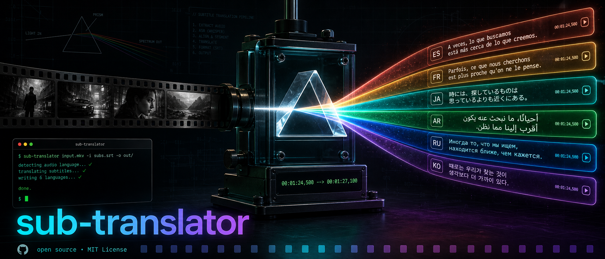

<div align="center">



<br/>
<br/>

[](https://golang.org)
[](LICENSE)
[](https://github.com/artschekoff/sub-translator/releases)

**One command turns a movie you can't understand into a movie you can.**

Extracts the subtitle track from a video file, translates it through an OpenAI model, and muxes the new track back in — no re-encoding.

**An OpenAI API key is required.** Translation is the one step this tool does not do locally; a run without a key refuses to start.

[The Problem](#the-problem) · [Installation](#installation) · [Usage](#usage) · [Transcription](#transcription) · [Translation](#translation) · [Configuration](#configuration) · [Driving it from another program](#driving-it-from-another-program) · [How It Works](#how-it-works) · [Development](#development)

</div>

---

## The Problem

You have a video with subtitles in a language you don't read. Getting it into a language you do read is normally a five-tool chore:

| The usual pain | What `sub-translator` does |
|---|---|
| **Manual extraction.** Open MKVToolNix, hunt for the right stream index, demux an `.srt` by hand. | Auto-detects the subtitle track by language code — `eng`, `en`, doesn't matter — and extracts it for you. |
| **Web translators mangle SRT files.** Paste a subtitle file into a translator and it "helpfully" translates the timecodes, breaks block numbering, and returns something no player will load. | Parses the SRT properly. Timing lines are copied **byte-for-byte**; only dialogue text is ever sent for translation. |
| **Slow, one-line-at-a-time translation.** Naive tools fire one request per subtitle block: thousands of round-trips for a feature film, each line translated with no idea what the last one said. | Batches ~40 blocks per request, each carrying the previous lines as context, with automatic per-block retry so one bad block can't poison the batch. |
| **Re-muxing loses quality.** Re-encoding to add a subtitle track costs an hour of CPU and a generation of video quality. | Stream-copies everything. Video and audio are untouched; only a new subtitle track is added. Takes seconds. |
| **AVI can't hold subtitles.** So the tool errors out and you're left with nothing. | Detects the container limitation and writes an external `.srt` next to the video instead — which is also what the default mode does for every container. |
| **No subtitles at all.** A rip with a single audio track and no subtitle stream leaves subtitle tools with nothing to work on. | Transcribes the audio with whisper.cpp, then translates the transcript — the same one command. |

The result is one command, a few seconds of waiting, and a file that plays with translated subs in any player.

## Features

- **Automatic track detection** — finds the right subtitle track by language code, no manual stream index needed
- **Sidecar or embedded** — writes a `.srt` next to your video by default, or embeds the translated track into a new container with `-mode mux`
- **Timing-safe translation** — timecode lines are never sent to the translator, so sync is preserved exactly
- **Smart batching** — groups subtitle blocks for fewer requests, in parallel where the endpoint can take it, with per-block fallback on failure
- **Context-aware dialogue** — every request carries the previous three lines, so names, who is addressing whom and formality survive from line to line
- **ISO 639-1/2 aware** — handles both `en` and `eng`, `es` and `spa` transparently
- **Multi-format muxing** — embeds the translated track into MKV/MP4; saves external SRT for AVI
- **Lossless** — stream copy only; your video and audio bits are never re-encoded
- **Progress output** — live `%` counter so you know it's working
- **Audio transcription** — no subtitle track? whisper.cpp transcribes the audio and the transcript is translated like any other subtitle file
- **Shared model store** — reuses `ggml-*.bin` models other whisper.cpp front-ends already downloaded, so a 1.6 GB model is never fetched twice
- **Remembered settings** — binary and model paths are configured once with `sub-translator config set`

## Supported Formats

| Container | `-mode srt` (default) | `-mode mux` | `-mode both` |
|-----------|:---------------------:|:-----------:|:------------:|
| MKV       | ✅ sidecar `.srt`     | ✅ embedded | ✅ |
| MP4 / M4V / MOV | ✅ sidecar `.srt` | ✅ embedded (`mov_text`) | ✅ |
| AVI       | ✅ sidecar `.srt`     | falls back to sidecar | falls back to sidecar |

AVI cannot carry subtitle tracks, so `-mode mux` and `-mode both` downgrade to a sidecar `.srt` and say so.

## Installation

**Prerequisites:** an [OpenAI API key](https://platform.openai.com/api-keys) — see [Translation](#translation) — and [ffmpeg](https://ffmpeg.org/download.html) in `$PATH`, which does the probing, extraction and muxing.

```bash
# macOS
brew install ffmpeg

# Ubuntu / Debian
sudo apt install ffmpeg
```

### From a release

Grab the archive for your platform from [Releases](https://github.com/artschekoff/sub-translator/releases), unpack it, and put the binary on your `$PATH`:

```bash
tar -xzf sub-translator-darwin-arm64.tar.gz
sudo mv sub-translator-darwin-arm64 /usr/local/bin/sub-translator
```

### From source

Needs [Go 1.26+](https://golang.org/dl/).

```bash
git clone https://github.com/artschekoff/sub-translator
cd sub-translator

make build      # -> ./bin/sub-translator
make install    # -> /usr/local/bin/sub-translator (uses sudo)
```

## Usage

```
sub-translator [flags] <input>
```

```
Flags:
  -from          source language code (prompted for if omitted; detected in audio mode)
  -to            target language code (required; prompted for if omitted)
  -source        subtitle source: sub, audio or auto (default: auto)
  -track         subtitle stream index, -1 = auto-detect by -from lang (default: -1)
  -atrack        audio stream index, -1 = auto (default: -1)
  -mode          output mode: srt, mux or both (default: srt)
  -out           output path (.srt in srt mode, container otherwise)
  -fast          translate progressively so the opening is watchable within a minute
  -chunk         chunk length in minutes for -fast (default 10, or whisper.chunk-minutes)
  -workers       batches translated at once (default 4, or translate.workers)
  -whisper-model path to a whisper ggml model
  -whisper-bin   path to the whisper-cli binary
  -vad-model     path to a Silero VAD model
  -probe         list the file's tracks and exit
  -events        emit machine-readable events on stderr: json
  -version       print version and exit
```

### Output modes

| Mode | What you get | When to use it |
|------|--------------|----------------|
| `srt` *(default)* | `movie.es.srt` next to the video | Fastest, non-destructive — your video file is never rewritten and no second copy lands on disk. Works with any player that loads sidecar subtitles. |
| `mux` | `movie.ES.mkv` with the translated track embedded | One self-contained file to copy to a TV, phone or media server that ignores sidecars. Costs a full copy of the video on disk. |
| `both` | `movie.ES.mkv` **and** `movie.es.srt` | You want the embedded track but also a plain-text copy to edit or reuse. |

### Examples

```bash
# Default: write movie.es.srt next to the video
sub-translator -from en -to es movie.mkv

# Omit the languages and you'll be asked for both
sub-translator movie.mkv

# Embed the translated track into a new container
sub-translator -from en -to fr -mode mux movie.mkv

# Embedded track plus a sidecar .srt
sub-translator -from en -to de -mode both movie.mp4

# Pick a specific subtitle track by stream index
sub-translator -from en -to ru -track 3 movie.mkv

# Custom output path (names the .srt in srt mode)
sub-translator -from en -to es -out /tmp/movie_es.srt movie.mkv

# Custom output path (names the container in mux mode)
sub-translator -from en -to es -mode mux -out /tmp/movie_es.mkv movie.mkv
```

### Track listing and prompts

Every run lists the subtitle tracks it found before doing anything else:

```
$ sub-translator movie.mkv
Probing movie.mkv...
Subtitle tracks:
  #2   lang=rus      Rus, SRT
  #3   lang=eng      Eng, SRT
Source language code (e.g. en, ru, es, fr): ru
Target language code (e.g. en, ru, es, fr): en
```

Neither `-from` nor `-to` has a default — guessing the languages silently is worse than asking — so an omitted flag prompts on stderr. When stdin isn't interactive (a pipe, CI), the run errors out instead of hanging.

The listing matters because plenty of releases ship subtitle tracks with **no language tag at all**:

```
Subtitle tracks:
  #2   lang=(none)   (none)
```

Auto-detection by `-from` can't match those, so pick the track by its stream index:

```bash
sub-translator -from ru -to en -track 2 movie.mkv
```

`-track` takes the **absolute** ffprobe stream index shown in the listing, not the position among subtitle tracks. With `-track` set, `-from` no longer selects the track — it only tells the translator what language the text is in. If the file has no subtitle streams at all, `-source sub` exits with `nothing to translate`; the default `-source auto` instead offers to transcribe the audio — see [Transcription](#transcription).

### Output naming

| Input | Flags | Output |
|-------|-------|--------|
| `movie.mkv` | *(default)* | `movie.es.srt` |
| `movie.mkv` | `-mode mux` | `movie.ES.mkv` |
| `movie.mkv` | `-mode both` | `movie.ES.mkv` + `movie.es.srt` |
| `movie.mp4` | `-to fr -mode mux` | `movie.FR.mp4` |
| `movie.avi` | `-mode mux` | `movie.es.srt` *(downgraded)* |

## Transcription

When a video has no subtitle track, `sub-translator` can generate one from the audio using [whisper.cpp](https://github.com/ggml-org/whisper.cpp).

**Prerequisites:**

```bash
brew install whisper.cpp              # provides the whisper-cli binary
sub-translator model pull large-v3-turbo
```

`model pull` downloads to `~/Library/Application Support/sub-translator/models` (macOS) or `~/.local/share/sub-translator/models` (Linux). If another whisper.cpp front-end has already downloaded a model, it is found and reused — the files use the same `ggml-<name>.bin` format and these locations are searched:

1. `models.dir` from the config, when set
2. `sub-translator`'s own install directory (the platform default above)
3. `~/Library/Application Support/net.slaive.app/models` (macOS)
4. `~/.cache/whisper.cpp`
5. `./models`

**Usage:**

```bash
# auto: uses the subtitle track if there is one, otherwise offers to transcribe
sub-translator -to es movie.mkv

# force transcription even when subtitle tracks exist
sub-translator -to es -source audio movie.mkv

# pick a specific audio track and skip language detection
sub-translator -to es -source audio -atrack 1 -from en movie.mkv
```

The source language is detected automatically, so `-from` is optional here. Passing it is faster and more reliable when you already know it.

The untranslated transcript is saved next to the video as `<video>.<lang>.srt`, so you can read it, fix a mis-heard name in it, or feed it somewhere else by hand — transcription is the expensive step and its output is worth keeping.

### Watching before it finishes

Transcription runs far faster than playback — about 14× real time on an M1 Pro — but the normal mode still writes nothing until the last block is done. `-fast` changes that: it transcribes and translates the film in ten-minute chunks and rewrites the subtitle file after each one, so the opening is watchable within a minute.

```bash
sub-translator -to es -source audio -fast movie.mkv
```

```
Saved SRT: movie.es.srt — covers 0:00–0:10:00, you can start watching
  extended to 0:20:00
  extended to 0:30:00
Done: movie.es.srt covers the full 2:19:08 — reload subtitles in your player
```

Your lead grows as you watch: by the time you reach minute ten of the film, the file already covers minute one hundred and twenty.

**Reload the subtitles once at the end.** Players read a `.srt` when they load it and do not notice the file growing, so the track you started with covers only the first chunk. Re-selecting the subtitle track picks up the finished file. On macOS a desktop notification fires when it is complete.

Chunk length is `-chunk N` minutes, or `whisper.chunk-minutes` in the config; both default to 10. A line spoken across a chunk boundary is split into two, which is the cost of not waiting.

`-fast` requires `-source audio` (there is nothing to wait for when a subtitle track already exists) and the default `-mode srt` (a video container cannot be rewritten piece by piece).

**Voice activity detection** is off by default. It skips silence and can prevent whisper's decoder from looping on long quiet stretches, but measured against the same model it merges speech into longer, less punctuated subtitle blocks — so it is worth turning on only if you actually hit the looping problem, not as a general-purpose default. The symptom is unmistakable: the progress counter stalls, the run takes far longer than the audio it is transcribing, and the same line repeats over and over in the output. Enable it by pointing at a model explicitly, either for one run or persistently:

```bash
sub-translator model pull silero-vad

sub-translator -to es -source audio -vad-model ~/models/ggml-silero-v5.1.2.bin movie.mkv
# or persistently:
sub-translator config set whisper.vad-model ~/models/ggml-silero-v5.1.2.bin
```

## Translation

Translation goes through the OpenAI API, so a key is required:

```bash
export OPENAI_API_KEY=sk-...                      # or:
sub-translator config set translate.api-key sk-...
```

The key is read from `OPENAI_API_KEY` first, then from `translate.api-key`. With neither set, a run refuses to start and says so before the video is even probed — it does not get discovered an hour into a transcription. `config list` shows the key masked (`sk-…a4f2`); `config get translate.api-key` prints it in full, because that is how a script reads it back.

Set `OPENAI_BASE_URL` to redirect every translation request the run makes, for the same three reasons anyone points a chat client at a different URL: an OpenAI-compatible local server, a corporate proxy, or an Azure OpenAI endpoint. It is environment-only — there is no config equivalent — because it redirects a whole invocation rather than persisting a setting a user could forget they wrote and then spend an hour debugging a network problem that is really a wrong endpoint.

```bash
OPENAI_BASE_URL=https://your-proxy.example.com/v1/chat/completions sub-translator -to es movie.mkv
```

Each request carries 40 subtitle blocks plus the three source lines before them as context, so names, who is addressing whom and formality survive from line to line. Timing lines are never sent.

The model is `translate.model`, default **`gpt-6-luna`**. Of the current line — Astra for complex reasoning, Sol for a balance of intelligence and cost, Luna for cost-sensitive high-volume work — subtitles are the high-volume case and not a reasoning problem, so Luna is the right default. Set another id if you disagree:

```bash
sub-translator config set translate.model gpt-6-sol
```

**What it costs.** A feature film is roughly 1500 subtitle blocks, which is a few hundred thousand tokens once the prompts and context are counted — well under a dollar on Luna. A TV episode is a fraction of that. You are paying for the context, not for the words.

**Parallelism.** `-workers` sets how many batches are in flight at once, and the default is **4**: enough to hide the round-trip latency that otherwise dominates a run, and the difference between minutes and tens of minutes on a feature film. `-workers N` or `translate.workers` overrides it in both directions — raise it if your quota is generous, or drop it to 1 while you are being throttled.

```bash
sub-translator -workers 8 -to es movie.mkv
sub-translator -workers 1 -to es movie.mkv            # sequential
```

## Configuration

Settings live in `~/.config/sub-translator/config.json` and are managed from the command line:

```bash
sub-translator config list
sub-translator config set whisper.model ~/models/ggml-large-v3-turbo.bin
sub-translator config set whisper.bin /opt/homebrew/bin/whisper-cli
sub-translator config get whisper.model
sub-translator config path
```

| Key | Meaning |
|---|---|
| `whisper.bin` | Path to `whisper-cli`. Found on `$PATH` when unset. |
| `whisper.model` | Path to a ggml transcription model. Discovered when unset. |
| `whisper.vad-model` | Path to a Silero VAD model. Off unless set here or with `-vad-model`. |
| `whisper.vad-threshold` | Speech detection threshold, 0–1. whisper's default when unset. |
| `whisper.threads` | Threads for transcription. whisper chooses when unset. |
| `whisper.language` | Default source language. `auto` when unset. |
| `whisper.chunk-minutes` | Chunk length for `-fast`, in minutes. 10 when unset. |
| `models.dir` | Where `model pull` writes, and the first directory searched. |
| `translate.api-key` | OpenAI API key. `OPENAI_API_KEY` wins over it. Masked in `config list`. |
| `translate.model` | OpenAI model id. `gpt-6-luna` when unset. |
| `translate.workers` | Batches translated at once. 4 when unset. |

The corresponding flags — `-whisper-model`, `-whisper-bin`, `-vad-model`, `-chunk`, `-workers` — override the config for a single run.

## Driving it from another program

`-events json` makes the tool write newline-delimited JSON to **stderr**, one object per line, while stdout keeps the same human-readable output it has always had. Nothing changes without the flag:

```bash
sub-translator -events json -to es -source audio -fast movie.mkv 2> events.jsonl
```

**Skip the lines that are not JSON.** stderr carries this tool's own prose as well as the events, by design: the `warning:` lines, the one `error:` line, the usage text, and the interactive prompts. A consumer must therefore treat a line that does not parse as JSON as human output and ignore it, rather than treating it as a protocol error. Every line this tool writes is whole — the events and the prose share one lock, so neither can land inside the other, and an event emitted while a line is unfinished (an interactive prompt, which ends without a newline because the answer is typed on the same line) breaks that line first rather than continuing it — and the ffmpeg children's output no longer reaches stderr at all: it is captured and surfaced only in the error message of a step that failed. (The visible consequence for a person is that a run no longer prints ffmpeg's progress chatter.)

Every event carries `type` and `t` (an RFC 3339 UTC timestamp). The first line of any run is always a `version` event, so a consumer can refuse a stream it does not understand rather than guess. The shape below — every event, field and omission — was verified by running a `-fast` transcription against this code:

```json
{"type":"version","t":"2026-09-27T16:49:08Z","events":1,"tool":"1.4.0"}
{"type":"probe","t":"2026-09-27T16:49:08Z","duration":8348.674,"audio":[{"index":1,"lang":"eng","title":"Original","codec":"ac3"}],"subtitles":[],"fast":{"sources":["audio"],"modes":["srt"],"min_chunk_minutes":1}}
{"type":"stage","t":"2026-09-27T16:49:08Z","name":"extract"}
{"type":"stage","t":"2026-09-27T16:49:08Z","name":"transcribe","chunk":1,"of":14,"from":"0:00:00","to":"0:10:00"}
{"type":"progress","t":"2026-09-27T16:49:09Z","pct":100}
{"type":"language","t":"2026-09-27T16:49:09Z","detected":"en"}
{"type":"stage","t":"2026-09-27T16:49:09Z","name":"translate","chunk":1,"of":14}
{"type":"progress","t":"2026-09-27T16:49:09Z","pct":100}
{"type":"saved","t":"2026-09-27T16:49:09Z","path":"/…/movie.es.srt","covers":"0:10:00","watchable":true}
{"type":"stage","t":"2026-09-27T16:49:09Z","name":"transcribe","chunk":2,"of":14,"from":"0:10:00","to":"0:20:00"}
{"type":"progress","t":"2026-09-27T16:49:09Z","pct":100}
{"type":"stage","t":"2026-09-27T16:49:09Z","name":"translate","chunk":2,"of":14}
{"type":"progress","t":"2026-09-27T16:49:09Z","pct":100}
{"type":"saved","t":"2026-09-27T16:49:09Z","path":"/…/movie.es.srt","covers":"0:20:00","watchable":true}
{"type":"done","t":"2026-09-27T16:49:10Z","path":"/…/movie.es.srt","covers":"2:19:08"}
```

Simplified for readability, in four ways worth knowing about: the paths and the track metadata are shortened; the run's fourteen chunks are trimmed to two; each `progress` burst is shown as the single event that ends it, where a real run emits one per batch of blocks translated and one per percentage whisper reports, so a fourteen-chunk film produces hundreds of them; and the `language` line is shown where a run that was not told `-from` emits it (the verified run named its source language, so it had nothing to report).

`language` is emitted once, when whisper reports a source language that differs from the one that was asked for (including when none was asked for). Everything downstream — the transcript sidecar's filename, the translation — uses the language in that event from then on.

`probe.fast` states the `-fast` rule as data — the `-source` values and `-mode` values it accepts, and the minimum `-chunk`, in minutes — so a caller can disable a "fast mode" control with a reason instead of holding its own copy of the rule. It is the same object on the ordinary run's `probe` event and on `-probe`'s.

The `stage` names are the five phases a run can go through:

| `stage.name` | The phase |
|---|---|
| `extract` | decoding the chosen audio track to a 16 kHz WAV (`-source audio`) |
| `extract-subs` | extracting an existing subtitle track and parsing it (`-source sub`) |
| `transcribe` | whisper.cpp turning audio into text; carries `chunk`/`of`/`from`/`to` under `-fast` |
| `translate` | the OpenAI round trips; carries `chunk`/`of` under `-fast` |
| `mux` | writing the new container (`-mode mux`/`both`) |

`progress` carries no stage of its own: a consumer reads it against the most recent `stage` event, which is always the one immediately before the burst.

`warning` reports blocks that could not be translated and kept their original text. Its `kind` is currently always `"blocks_untranslated"` — it is there so a second kind of warning can be added without breaking a consumer — `count` is how many blocks kept their source text, and `total` is how many blocks the run produced in all (for `-fast`, the whole film's merged blocks, not one chunk's). A warning always precedes `done`, never follows it.

The ordinary run (no `-fast`) emits a different, shorter sequence: `probe`, then — only when transcribing audio — a bare `stage` `extract` and a bare `stage` `transcribe` with no `chunk`/`of`/`from`/`to` at all, then `progress`, then a single bare `stage` `translate`, then `progress`, then `done` with no `covers`. Reading an existing subtitle track emits `stage` `extract-subs` instead of the two transcription stages. `-mode mux` or `both` adds a `stage` `mux` after translation. Either run may also emit a `warning` before `done`, or end in a single `error` instead of `done`.

A field that does not apply to the current run is left out of the JSON rather than sent as a zero or empty string — `omitempty` in the Go source means "unknown here", not "the default":

- `probe.duration` — omitted when ffprobe's own duration could not be read; never sent as `0`.
- `stage.chunk`, `stage.of`, `stage.from`, `stage.to` — only `-fast` sets these, on the `transcribe` stage (all four) and the `translate` stage (`chunk`/`of` only); the ordinary run's stage events never carry them.
- `done.covers` — only `-fast` knows what span of the film's own runtime is covered; the ordinary run translates whatever it parsed in one pass and has no honest value to put here.
- `warning.first` — omitted when there is nothing to list.

`probe.fast` is never omitted — every `probe` event states the `-fast` rule.

`-probe` prints the `version` and `probe` events (or, without `-events json`, the same human-readable track listing the tool already prints) and exits without doing any work. It needs no API key and no target language:

```bash
sub-translator -events json -probe movie.mkv
```

**`-probe`, `-version`, `-h` and the subcommands carry no terminal event.** None of them is a run: each emits `version` (and `-probe` its `probe`), exits 0, and emits no `done` and no `error`. A decoder shared between a probe call, a settings read and a run must not wait for a terminal event on those.

**`-events json` composes with the `config` and `model` subcommands.** They print plain text on stdout and have no run to report, so the flag is taken out of the arguments the subcommand counts — `config get translate.model -events json` is still a one-key `get` — the stdout is identical to the same command without the flag, and the stream carries the `version` event alone:

```bash
sub-translator config get translate.model -events json
```

so a wrapper can append `-events json` to every invocation it makes, including the ones that read and write settings.

**Write `-events json` before the input path.** Like every flag this tool takes, it is only read while the arguments still look like flags: `sub-translator movie.mkv -events json` treats the flag as a positional argument and emits nothing, exactly as `-to es` after the path would be ignored.

Every fatal error carries a `kind` so a program can act on the reason instead of matching on wording. The message stays exactly as it is today:

| `kind` | Raised when |
|---|---|
| `missing_key` | no OpenAI key in the environment or the config |
| `invalid_key` | the translation endpoint rejected the key — HTTP 401 or 403 |
| `whisper_not_found` | `whisper-cli` is neither configured nor on `PATH` |
| `no_model` | no ggml model configured or discovered |
| `ambiguous_model` | several models found, none chosen |
| `no_audio_track` | `-source audio` (or `-fast`) on a file with no audio track, or `-atrack` pointing at one that doesn't exist |
| `no_subtitle_track` | `-source sub` on a file with none, `-track` pointing at a stream that isn't a subtitle track, or `-from` matching no subtitle track's language |
| `probe_failed` | the input file doesn't exist, or ffprobe could not read it |
| `output_unwritable` | a path the user chose — the sidecar `.srt`, or the muxed container — could not be written: a read-only directory, a full disk, a name the filesystem refuses |
| `rate_limited` | the translation endpoint returned HTTP 429 for every block in the run |
| `transcript_empty` | the audio produced no speech at all |
| `cancelled` | SIGINT or SIGTERM |
| `other` | anything not yet classified — including a usage error, an unreachable endpoint, and a reply the model mangled |

`invalid_key` and `rate_limited` are deliberately separate: a key with a typo in it is fixed in the settings, and retrying it can never succeed, while a rate limit is waited out. The first five kinds in the table are the ones a wrapper takes to a settings screen.

Every fatal path emits exactly one `error` event — a classified `fatalKindf` call emits its own `kind`; anything else falls through `fatalf`, which emits `other` — so a consumer driving this as a subprocess never sees a non-zero exit with silence on the wire. The single exception is `-events <anything but json>`: that exits 1 having emitted nothing, because the value being refused is the one that says how to answer. A consumer that builds its own argv never hits it; one that passes a format through from elsewhere should treat exit 1 with an empty stream as "this build does not speak that format".

Exit codes, and the event that pairs with each:

| Exit | Meaning | Terminal event |
|---|---|---|
| 0 | the run finished | one `done` — none for `-probe`, `-version`, `-h` or a subcommand |
| 1 | a fatal error | one `error`, with the `kind` from the table above (none for an unsupported `-events` value) |
| 2 | a usage error: an unknown flag or a bad flag value | one `error`, kind `other`, after the `version` event |
| 130 | cancelled by SIGINT or SIGTERM | one `error`, kind `cancelled` |

This is the same idea as `git status --porcelain` or `ffmpeg -progress`: a stable contract for programs, separate from the output meant for people.

## Languages

Use standard [ISO 639-1](https://en.wikipedia.org/wiki/List_of_ISO_639-1_codes) two-letter codes. Both `en`/`eng` forms are accepted as input.

| Code | Language   | Code | Language   | Code | Language  |
|------|------------|------|------------|------|-----------|
| `es` | Spanish    | `fr` | French     | `de` | German    |
| `it` | Italian    | `pt` | Portuguese | `ru` | Russian   |
| `zh` | Chinese    | `ja` | Japanese   | `ko` | Korean    |
| `ar` | Arabic     | `pl` | Polish     | `nl` | Dutch     |
| `tr` | Turkish    | `uk` | Ukrainian  | `sv` | Swedish   |

The table above is just a reference. The codes are passed to the model in its instructions, so any language it can name works.

## How It Works

```
input.mkv
    │
    ├─ ffprobe   →  detect subtitle tracks
    ├─ ffmpeg    →  extract .srt (stream copy, no decode)
    ├─ parse     →  split into blocks, preserve timing lines exactly
    ├─ translate →  batch requests to the OpenAI API (40 blocks/req, with context)
    ├─ rebuild   →  merge translated text back, timing untouched
    └─ ffmpeg    →  mux new track into output container (stream copy)
```

Timing lines (`00:00:00,000 --> 00:00:00,000`) are copied verbatim — translation never touches them. Every ffmpeg call is a stream copy, so the pipeline is I/O-bound, not CPU-bound: a two-hour film is done in seconds plus translation time.

## Project Layout

```
main.go               flag parsing + pipeline orchestration
source.go             subtitle source (sub / audio / auto) parsing and resolution
mode.go               output mode (srt / mux / both) parsing and container fallback
ui.go                 track listing, language and confirmation prompts
cmd_config.go         `config list|get|set|path` subcommand
cmd_model.go          `model list|pull` subcommand
internal/media/       ffprobe / ffmpeg wrappers: probe, extract, mux, path naming
internal/srt/         SRT parse, rebuild, write
internal/translate/   batched translation: worker pool, OpenAI chat endpoint
internal/whisper/     whisper.cpp CLI wrapper: binary lookup, flags, progress
internal/config/      ~/.config/sub-translator/config.json read, write, get, set
internal/models/      ggml model catalog, search directories, discovery, download
```

## Development

| Target | What it does |
|--------|--------------|
| `make build`     | Build `./bin/sub-translator` with the version stamped in |
| `make build-all` | Cross-compile darwin/linux (amd64 + arm64) and windows/amd64 |
| `make pack`      | `build-all`, then archive each binary into `./bin/dist` |
| `make install`   | Build and copy to `/usr/local/bin` (uses `sudo`) |
| `make test`      | `go test ./... -v` |
| `make fmt`       | `gofmt -w .` |
| `make vet`       | `go vet ./...` |
| `make tidy`      | `go mod tidy` |
| `make validate`  | `fmt` + `vet` + `test` |
| `make clean`     | Remove `./bin` |
| `make release`   | Interactive version bump → tag → push → pack → GitHub release |

`make release` reads the latest tag, prompts for a `major`/`minor`/`patch` bump (default `patch`), tags and pushes the new version, packs the cross-compiled archives, and publishes them with `gh release create --generate-notes`. It needs the [`gh` CLI](https://cli.github.com/) authenticated against this repo.

## License

MIT — see [LICENSE](LICENSE).
